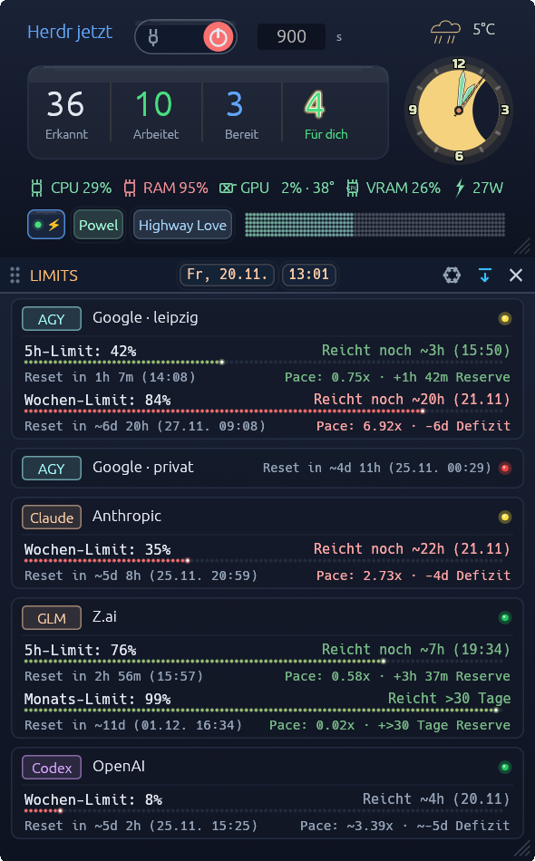

# desktop-snap

A WGC-only Windows screenshot CLI for WSL2, with built-in privacy guardrails.

`desktop-snap` takes reliable screenshots of hardware-accelerated OpenGL, Vulkan, DirectX and transparent DWM windows on Windows 11, driven from WSL2. It uses the native **Windows Graphics Capture (WGC)** API. Classic GDI paths (`BitBlt`, `ImageGrab`, `PrintWindow`) return white or empty surfaces for these windows, so the tool never falls back to them. It also never steals focus.

The project has two parts:

- `desktop-snap.exe`, a Rust program for Windows (`x86_64-pc-windows-gnu`). It enumerates windows, enforces the policy, captures frames and writes PNG files.
- `bin/desktop-snap`, a Python 3 wrapper (standard library only) that runs on the WSL side. It stages files through local Windows temp, enforces timeouts, keeps the audit log and passes receipts and exit codes through unchanged.

## Example



This screenshot is just an example of what `desktop-snap` captures cleanly: it was taken live from WSL2 using `desktop-snap preset nightwatcher --out ./nightwatcher.png` (`wgc-composite`, `590×950`, `12,049` distinct colors, `653 ms`), stitching two transparent, borderless OpenGL (`eframe`/`glow`) windows via `DWMWA_EXTENDED_FRAME_BOUNDS` with preserved corner transparency.

The app shown is [Herdr Night Watch](https://github.com/simfor99/herdr-night-watch), a companion project of mine that works alongside **Herdr** to keep an eye on both system hardware telemetry (CPU, RAM, GPU, VRAM, power draw) and LLM usage limits and pacing directly on the Windows desktop. `desktop-snap` itself has no dependency on it — it works with any Windows application.

## Features

- **WGC only.** Frames come from `Windows.Graphics.Capture`. There is no GDI, `BitBlt`, `PrintWindow` or DXGI fallback. If WGC is denied, the tool fails with exit code `5`.
- **Transparency preserved.** Captures are written as RGBA PNG. `--flatten-bg #RRGGBB` adds an opaque background if you need one.
- **Flat-image check.** A nearly uniform image (`top_color_share >= 0.92` and `distinct_colors <= 50`, counted over visible pixels) is rejected with exit code `2`, and no file is written.
- **Single-window, group and region capture.** Select windows by title substring, process name or HWND. Ambiguous matches fail with exit code `3` and list the candidates.
- **Privacy guardrails.** A denylist compiled into the EXE blocks password managers, Windows security prompts, remote-access tools and browser incognito or online-banking titles. Windows whose process name cannot be read are denied. `list` shows no window titles unless you ask with `--titles`.
- **Explicit full-screen gate.** Full-monitor captures need `--allow-full-monitor`. Without it, the tool exits with code `8`.
- **No focus changes.** The tool never calls `SetForegroundWindow`, restores minimised windows, or moves the mouse.

## Requirements

- Windows 11 (WGC is required; `doctor` reports whether it is supported).
- WSL2 with Python 3.8 or newer.
- To build: Rust with the `x86_64-pc-windows-gnu` target and the mingw-w64 toolchain.

## Build

```bash
rustup target add x86_64-pc-windows-gnu
sudo apt install mingw-w64
cargo build --release --target x86_64-pc-windows-gnu
# -> target/x86_64-pc-windows-gnu/release/desktop-snap.exe
```

## Install

1. Copy the EXE to `%USERPROFILE%\Apps\DesktopSnap\desktop-snap.exe`.
2. Put the wrapper on your `PATH`:

   ```bash
   ln -s "$PWD/bin/desktop-snap" ~/.local/bin/desktop-snap
   ```

3. Check the installation:

   ```bash
   desktop-snap --version
   desktop-snap doctor
   ```

The wrapper derives the Windows paths from your current user profile. You do not need to edit any file for a standard setup.

### Environment variables

| Variable | Purpose | Default |
| :--- | :--- | :--- |
| `DESKTOP_SNAP_EXE` | Path to the EXE, as seen from WSL | `<profile>\Apps\DesktopSnap\desktop-snap.exe` |
| `DESKTOP_SNAP_STAGING_DIR` | Staging directory, as seen from WSL | `<LocalAppData>\Temp\desktop-snap` |
| `DESKTOP_SNAP_STAGING_WIN_DIR` | Staging directory, as seen from Windows | `<LocalAppData>\Temp\desktop-snap` |
| `DESKTOP_SNAP_DESKTOP_TEMP` | Target of `--copy-desktop-temp` | `<profile>\Desktop\temp` |
| `DESKTOP_SNAP_CONFIG_DIR` | Presets and denylist directory | `~/.config/desktop-snap` |
| `DESKTOP_SNAP_STATE_DIR` | Audit log directory | `~/.local/state/desktop-snap` |
| `DESKTOP_SNAP_WIN_USER` | Windows profile path, skips the lookup | (resolved with `cmd.exe`) |
| `DESKTOP_SNAP_CALLER` | Caller label for the audit log | `HERDR_PANE_ID`, then `TMUX_PANE` |

## Usage

```bash
desktop-snap window --title "Live-Status" --out ./live.png
desktop-snap window --process Herdr-Nachtwaechter.exe --title "Limits" --out ./limits.png
desktop-snap group --match "Live-Status" --match "Limits" --out ./group.png
desktop-snap preset nightwatcher --out ./nightwatcher.png --copy-desktop-temp
desktop-snap preset herdr --out ./herdr.png
desktop-snap region --process Herdr-Nachtwaechter.exe --x 0 --y 0 --w 590 --h 285 --out ./region.png
desktop-snap monitor --index 0 --allow-full-monitor --out ./monitor.png
desktop-snap list
desktop-snap list --titles
desktop-snap doctor
```

Every command prints one JSON receipt on stdout. The process exits with the same code as the receipt's `exit_code`. The flag `--json` is accepted, and the output is JSON either way.

### Presets

Presets live in `~/.config/desktop-snap/presets.json`. A repository default is used when the user file does not define the preset:

```json
{
  "version": 1,
  "presets": {
    "nightwatcher": [
      { "process": "Herdr-Nachtwaechter.exe", "title": "Herdr-Nachtwächter - Live-Status" },
      { "process": "Herdr-Nachtwaechter.exe", "title": "Herdr-Nachtwächter - Limits" }
    ]
  }
}
```

Each entry becomes one `--match` of a `group` capture.

### Denylist

`~/.config/desktop-snap/denylist.json` can add entries to the built-in denylist. It can never remove one. The wrapper copies it into staging and passes it with `--extra-denylist`.

## Exit codes

| Exit | `error_code` | Meaning |
| :--- | :--- | :--- |
| `0` | `null` | Capture succeeded |
| `1` | `not_found` | No visible, uncloaked window matched (`preset_not_found` for unknown presets) |
| `2` | `flat_image` | The image is nearly uniform; no file was written |
| `3` | `ambiguous_match` | More than one window matched; the candidates are listed |
| `4` | `window_minimized` / `no_frame` | Window is minimised, or no frame arrived within 2 seconds |
| `5` | `capture_denied` | WGC refused access (for example `WDA_EXCLUDEFROMCAPTURE`); no fallback |
| `6` | `denied_sensitive_window` | A denylist entry matched; no pixels were written |
| `7` | `timeout` / `runtime_error` | Wrapper timeout, missing EXE, invalid arguments or an internal error |
| `8` | `policy_denied` | Policy refused the request, for example a full-monitor capture without `--allow-full-monitor` |

## Audit log

Every capture attempt through the wrapper, successful or refused, appends one JSON line to `~/.local/state/desktop-snap/audit.jsonl`. The writes are serialised with `flock`, and the file keeps the newest 1000 lines. Each line holds metadata only: timestamp, caller, mode, target, processes, backend, result, exit code, output path, SHA-256, flat flag and duration. No pixel data is stored.

## Tests

```bash
python3 -m pytest -q tests
cargo test
```

The wrapper tests replace the EXE with a fake stub, so they run without Windows.

## Security notes

- The denylist and the containment checks live in the EXE. Calling the EXE directly therefore gets the same protection, although only wrapper calls appear in the audit log.
- Transient files stay in the local Windows temp directory and are removed after each run. Stale files older than one hour are cleaned up on start.
- Subprocesses run with stdin closed and in their own process group. On timeout the group receives `SIGTERM`, then `SIGKILL` after at most two seconds.

## License

MIT. See [LICENSE](LICENSE).
